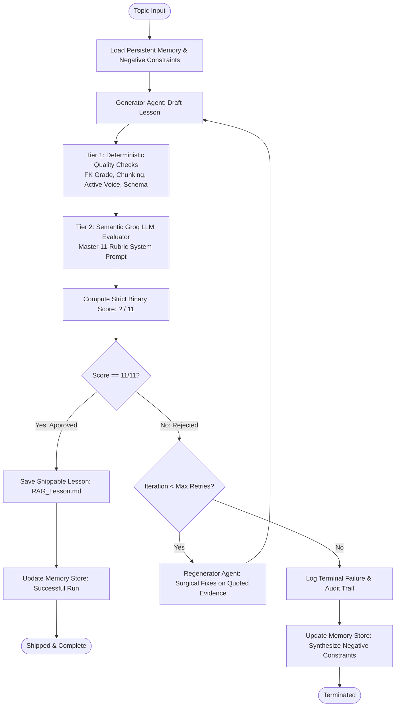

# 🛡️ Autonomous AI Lesson Quality-Gate & Self-Evaluating Content Engine

[](https://www.python.org/)
[-orange.svg)](https://groq.com/)
[](https://streamlit.io/)
[](#the-11-hard-passfail-rubric-checkpoints)

> **Assessment Submission:** GenAI Engineer — Content Systems  
> **Topic:** Introduction to RAG (Retrieval-Augmented Generation)  
> **Target Audience:** Indian Class 12 Graduate, non-English-medium background, CEFR A2–B1 vocabulary, zero prior AI/tech background.

---

## 🎯 Executive Overview

In educational content generation, the core challenge is not writing a clever prompt—it is **building an autonomous agentic system that continuously evaluates its own quality against strict educational rubrics, rejects subpar drafts, and surgically regenerates until the lesson clears a high quality bar before a human ever sees it**.

This system implements an end-to-end **Generate ➔ Evaluate ➔ Regenerate** closed-loop state machine with:
1. **Hybrid Two-Tier Quality Gates**: Zero-token mathematical Python checks (Flesch-Kincaid grade level, chunking limits, passive voice) + deep LLM semantic validation.
2. **Strict 11/11 Binary Passing Bar**: No partial credit. A lesson scoring 10/11 is strictly rejected.
3. **Surgical Self-Correction**: Feedback loops provide exact failure reasons and quoted evidence back to the generator.
4. **Self-Evolving Cross-Run Memory**: Automatically records failure modes and dynamically injects negative constraints into future system prompts.
5. **Interactive Streamlit UI + Rich CLI**: Includes a **Deliberate Error Injection** harness for demonstrations and audits.

---

## 🏗️ System Architecture



---

## 👥 Target Learner Persona & Pedagogical Scaffolding

This engine is tuned for a specific, underserved demographic in technical education:
- **Demographic**: 12th-grade pass-out from India, non-English-medium schooling background.
- **English Proficiency**: CEFR A2–B1 level (familiar everyday conversational English, simple sentence structures).
- **Prior Knowledge**: Zero programming, zero computer science, zero mathematics/linear algebra.
- **Pedagogical Anchors**:
  - Abstract concepts are introduced **only after** an everyday Indian real-world situation (e.g., *kirana store wholesale call, doctor checking blood reports, school library, open-book exam*).
  - **Zero Unexplained Jargon**: Every technical acronym or term (`RAG`, `LLM`, `API`, `Database`, `Retrieval`) must be defined in plain, friendly English immediately on its very first appearance.
  - **Cognitive Load Chunking**: Max 4 sentences/paragraph, max 60 words/paragraph, max 25 words/sentence.

---

## 📋 The 11 Hard Pass/Fail Rubric Checkpoints

Each checkpoint is strictly binary: **1 (PASS)** or **0 (FAIL)**. The approval threshold is **11/11**.

| # | Checkpoint Name | Evaluator Type | Strict Failure Condition (Score = 0) |
|---|---|---|---|
| **1** | **Target Persona & Vocabulary** | Deterministic + LLM | Flesch-Kincaid Grade Level > 7.0 or vocabulary exceeding CEFR B1. |
| **2** | **Grounded Indian Analogy** | Semantic (LLM) | Missing an intuitive Indian real-world analogy (kirana, exam, railway, doctor) that correctly explains the mechanism. |
| **3** | **Zero Unexplained Technical Jargon** | Semantic (LLM) | Any technical term (vector, embedding, LLM, API, database) appears without an immediate plain-English explanation. |
| **4** | **Factual & Technical Grounding** | Semantic (LLM) | Technically incorrect claims (e.g., claiming RAG fine-tunes weights or invents facts). |
| **5** | **Core Pedagogical Coverage** | Semantic (LLM) | Missing any of the 4 pillars: *What is it, Why it matters, How it works, Real-world use case*. |
| **6** | **Coherent Flow & Micro-Check** | Semantic (LLM) | Missing progressive disclosure or lacking exactly two quiz questions with full explanations. |
| **7** | **Bite-Sized Chunking & Cognitive Load** | Deterministic (Python) | Any prose paragraph > 4 sentences, > 60 words, or any sentence > 25 words. |
| **8** | **Actionable Mental Experiment** | Semantic (LLM) | Missing an explicit scenario starting with *"Imagine this..."* placing the learner inside the problem. |
| **9** | **Learner-Centric Active Voice** | Deterministic (Python) | Passive voice usage > 20% of explanatory sentences. |
| **10** | **Concept-to-Application Transfer** | Semantic (LLM) | Lacks practical problem-solving context or both quiz questions only test simple memorization. |
| **11** | **Structured Content Contract** | Deterministic + LLM | Missing mandatory sections or invalid quiz schema. |

---

## 🔁 Self-Evolving Cross-Run Memory

The system maintains a persistent memory store in `data/memory.json`.
- **Failure Frequency Tracking**: When a rubric fails across multiple runs, its failure weight increases.
- **Dynamic Negative Constraints**: If an error pattern recurs $\ge 2$ times, the system automatically synthesizes a **Dynamic Negative Constraint** and injects it into future generation prompts (e.g., *"Strict Warning: Past evaluations frequently failed on 'Zero Unexplained Technical Jargon'. Define abbreviations immediately."*).
- **Audit Trails**: Every cycle's diff, quoted evidence, and score are logged to `data/audit_logs/run_{timestamp}.json`.

---

## 📁 Repository Structure

```
.
├── .env.example             # Template for API keys
├── .gitignore               # Excludes secrets, venv, and cache
├── requirements.txt         # Core dependencies
├── README.md                # Engineering overview & documentation
├── app.py                   # Interactive Streamlit Web Dashboard
├── cli.py                   # Headless CLI runner
├── data/
│   ├── memory.json          # Persistent cross-run failure learning store
│   └── audit_logs/          # Chronological JSON logs of all runs
├── final_output/
│   ├── RAG_Lesson.md        # The final approved shippable lesson (11/11)
│   └── Rejection_Log.md     # Complete rejection & surgical fix audit trail
├── docs/
│   └── LOOM_DEMO_SCRIPT.md  # 15–20 min Loom video recording script
└── src/
    ├── __init__.py
    ├── config.py            # Model parameters and readability thresholds
    ├── models.py            # Pydantic schemas (EvaluationOutput, RubricResult, Lesson)
    ├── generator.py         # Generation agent with deliberate flaw injector
    ├── memory.py            # Cross-run memory store & constraint synthesizer
    ├── graph.py             # Agentic cyclic workflow state machine
    └── evaluators/
        ├── __init__.py
        ├── deterministic.py # Python math/textstat checks (FK Grade, Chunking, Voice)
        └── semantic.py      # Groq LLM Master 11-Rubric Evaluator
```

---

## 🚀 Setup & Execution Guide

### 1. Prerequisites
- Python 3.10 or higher.
- A free API key from [Groq Cloud](https://console.groq.com/keys).

### 2. Installation
```powershell
# Clone the repository
git clone <your-repo-link>
cd <repo-folder>

# Create and activate virtual environment
python -m venv venv
.\venv\Scripts\Activate.ps1   # On Windows PowerShell
# source venv/bin/activate    # On Linux/macOS

# Install dependencies
pip install -r requirements.txt
```

### 3. Configure API Key
Create a `.env` file in the root directory (or copy `.env.example`):
```ini
GROQ_API_KEY=gsk_your_actual_groq_api_key_here
GROQ_MODEL=openai/gpt-oss-120b
MAX_RETRIES=2
APPROVAL_THRESHOLD=11
```

### 4. Running via Interactive Streamlit Dashboard (Recommended for Loom Demo)
```powershell
streamlit run app.py
```
Open your browser to `http://localhost:8501`. You can:
- Run normal generation.
- Toggle the **Loom Demo Flaw Injection** dropdown (`unexplained_jargon`, `missing_analogy`, `poor_chunking`) to show the evaluator rejecting flaws live on camera.
- Inspect real-time 11-rubric scorecards, quoted evidence, and memory statistics.

### 5. Running via CLI
```powershell
# Standard run (Introduction to RAG)
python cli.py --topic "Introduction to RAG"

# Deliberate error injection run (demonstrates rejection and surgical recovery)
python cli.py --flaw unexplained_jargon
```

---

## 🔬 Evidence of System in Action

### Live Run 1: Standard Generation (Happy Path)
- **Iteration 1**: Initial draft produced.
- **Evaluation**: Passed all 11 rubrics on Cycle 1.
- **Score**: **11/11 (APPROVED & SHIPPED)**.
- Output saved to `final_output/RAG_Lesson.md`.

### Live Run 2: Deliberate Flaw Injection (`--flaw unexplained_jargon`)
- **Cycle 1**: Injected dense vector mathematics into the draft.
  - *Evaluator Decision*: **REJECTED (Score: 9/11)**.
  - *Violations Caught*: Rubric 1 (FK Grade 7.5 > 7.0) and Rubric 3 (Unexplained jargon: "high-dimensional cosine similarity across dense vector embeddings").
- **Cycle 2**: Generator removed vector jargon, but used abbreviation "AI" without introductory explanation.
  - *Evaluator Decision*: **REJECTED (Score: 10/11 - Zero Partial Credit Enforced)**.
  - *Violations Caught*: Rubric 3 ("AI appears without plain-English definition on first use").
- **Cycle 3**: Generator expanded "Artificial Intelligence (AI) - a computer program that can answer questions".
  - *Evaluator Decision*: **APPROVED & CLEARED FOR SHIPPING (Score: 11/11)**.
- Full audit log recorded in `final_output/Rejection_Log.md`.

---

## ⚖️ Engineering Trade-Offs & Design Decisions

1. **Why Hybrid Evaluation over 100% LLM Grading?**
   - LLMs are notoriously poor at strictly counting words, sentences, or calculating phonetic syllables. Offloading Rubrics 1, 7, 9, and 11 to Python (`textstat` and regex) ensures **zero-token cost, sub-millisecond execution, and 100% mathematical determinism**.
2. **Why Strict 11/11 Binary Threshold over Weighted Averages?**
   - In pedagogical content for vulnerable beginners, a single unexplained mathematical term can completely derail comprehension. A weighted average of 92% could mask a fatal pedagogical blocker. Strict binary gating guarantees standard compliance.
3. **Why Targeted Surgical Feedback over Full Re-prompting?**
   - Asking the model to "try again" causes it to hallucinate new flaws or discard sound sections. Providing exact quoted evidence and failure reasons enables localized, surgical corrections that converge in $\le 2$ iterations.

---

## 📄 Deliverable Links
- **Final Approved Lesson Content**: [final_output/RAG_Lesson.md](final_output/RAG_Lesson.md)
- **Rejection & Revision Audit Log**: [final_output/Rejection_Log.md](final_output/Rejection_Log.md)
- **15–20 Min Loom Video Script**: [docs/LOOM_DEMO_SCRIPT.md](docs/LOOM_DEMO_SCRIPT.md)
